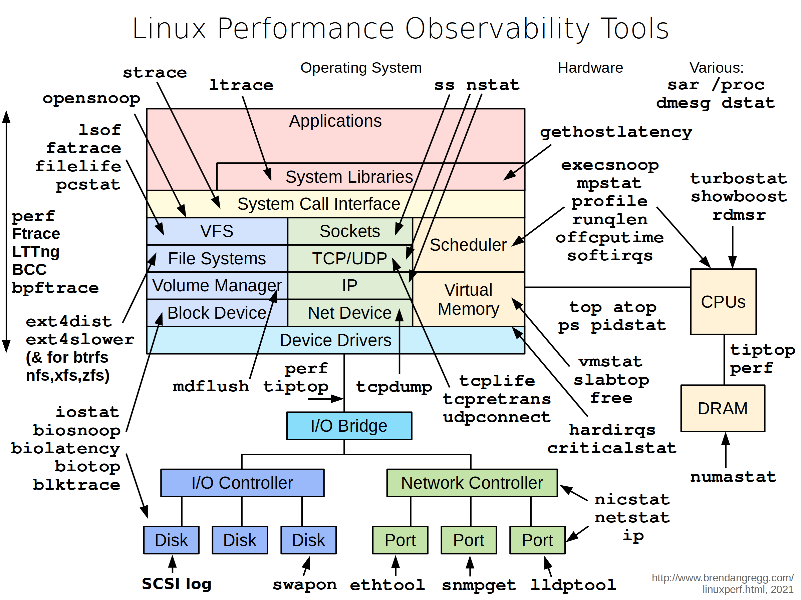

## Dijagnoziranje problema {#sec-dijagnoziranje-problema}

**Ciljevi**:

- Posmatrati program kao crnu kutiju (često ne znamo koji se kod izvršava)

- Analizirati ponašanje kako bi se pronašli uzroci problema

- Proširiti znanje o osnovnim alatima za merenje performansi

- Napraviti temelj za metodičnu analizu sistema - ne možemo raditi kvalitetnu analizu ako ne znamo šta i kako možemo analizirati

## Metodologija dijagnoziranja problema {#sec-metodologija-dijagnoziranja-problema}

Prvi korak u dijagnozi problema je određivanje opsega: da li je problem na nivou celog sistema, jednog procesa, jedne niti, diska, mreže ili spoljnog servisa. Alati iz ovog poglavlja ne traže poznavanje izvornog koda programa. Njihov cilj je da daju merenja i tragove koji usmeravaju dalju analizu.

Tipični koraci su:

1.  **Detekcija simptoma**: šta se vidi spolja, bez čitanja izvornog koda.

2.  **Reprodukcija**: tačna komanda, ulaz i vreme pokretanja.

3.  **Prvo merenje**: sistemski pregled koji potvrđuje da se simptom zaista dešava.

4.  **Sužavanje**: proces, nit, resurs ili sistemski poziv koji objašnjava simptom.

5.  **Potvrda**: alat bliži uzroku, na primer debager, profajler, sanitizer, Valgrind, KLEE ili CBMC.

6.  **Tumačenje**: šta iz izlaza alata dokazuje uzrok i šta bi bio sledeći inženjerski korak.

Korisno je znati gde Linux čuva sirove podatke o procesima, jezgrima, uređajima i sistemskoj konfiguraciji:

- `/proc` sadrži informacije o procesima, memoriji, CPU jezgrima, montiranim sistemima datoteka i parametrima kernela.

- `/sys` prikazuje model uređaja, drajvere, klase uređaja i deo konfiguracije hardvera.

## Alati za analizu performansi {#sec-alati-za-analizu-performansi}

Mnogi alati prikazani u nastavku čitaju podatke iz ovih direktorijuma i formatiraju ih u oblik pogodan za brzu analizu.

 Širi pregled Linux observability alata može se naći na [linku](https://www.brendangregg.com/linuxperf.html).

### `uptime` {#sec-uptime}

`uptime` daje najbrži odgovor na pitanje da li je sistem opterećen. Prikazuje trenutno vreme, koliko dugo sistem radi, broj korisnika i prosečno opterećenje u poslednjih 1, 5 i 15 minuta.

Alat je koristan kada treba brzo proveriti:

- da li je problem kratkotrajan ili traje duže;

- da li se opterećenje povećava ili smanjuje;

- da li ima smisla odmah preći na detaljnije alate kao što su `top`, `vmstat` ili `pidstat`.

``` bash
$ uptime
14:17:27 up  5:43,  1 user,  load average: 0.41, 0.93, 1.06
```

Prosek opterećenja dat je u intervalima od približno 1, 5 i 15 minuta. Vrednost predstavlja broj zadataka koji su spremni za izvršavanje ili čekaju neprekidiv I/O događaj. Zato visok load ne znači uvek da je CPU zauzet; uzrok može biti i spor disk ili mrežni sistem datoteka.

### `top` / `htop` {#sec-top--htop}

`top` i `htop` prikazuju interaktivni pregled sistema i procesa. Koriste se kada treba brzo videti koji proces troši CPU, memoriju ili veliki broj niti, kao i da li se stanje menja tokom vremena.

Najčešće se posmatraju:

- opšti CPU i memorijski redovi na vrhu prikaza;

- kolone `%CPU`, `%MEM`, `RES`, `S`, `TIME+` i `COMMAND`;

- procesi koji često menjaju stanje ili zauzimaju jedno CPU jezgro;

- niti procesa, ako se prikaz proširi na thread-ove.

Ovi alati su dobri za interaktivnu analizu dugotrajnog problema. Manje su pogodni za procese koji traju kratko, jer uzorkuju stanje u intervalima. Za takve slučajeve korisniji su `pidstat`, `sar` ili alat koji čuva istoriju, kao što je `atop`. `top` i `htop` takođe troše resurse, pa ih treba pažljivo koristiti na već opterećenom sistemu.

### `ps` {#sec-ps}

`ps` prikazuje trenutni snimak procesa. Za razliku od `top`, ne prati promene tokom vremena. Koristan je kada treba sačuvati stanje sistema u izveštaju, proveriti hijerarhiju procesa, argumente kojima je proces pokrenut ili stanje procesa.

`ps -ef f` prikazuje roditelj-dete odnose u obliku stabla. To je korisno kod servera koji pokreću radne procese, shell skripti koje pokreću druge programe i aplikacija koje ostavljaju procese nakon završetka roditelja.

``` bash
$ ps -ef f
[...]
root        1044       1  0 08:34 ?        Ssl    0:00 /usr/bin/lightdm
root        1056    1044  7 08:34 tty7     Ssl+  26:47  \_ /usr/lib/Xorg :0 -seat seat0 -auth /run/lightdm/root/:0
root        1088    1044  0 08:34 ?        Sl     0:00  \_ lightdm --session-child 13 16
ivan        1118    1088  0 08:34 ?        Ss     0:08      \_ i3
root        1050       1  0 08:34 ?        Ssl    0:00 /usr/lib/accounts-daemon
ivan        1095       1  0 08:34 ?        Ss     0:00 /usr/lib/systemd/systemd --user
ivan        1096    1095  0 08:34 ?        S      0:00  \_ (sd-pam)
[...]
```

### `vmstat` {#sec-vmstat}

`vmstat` daje sistemski pregled procesa, memorije, swap-a, ulaza/izlaza, prekida, promene konteksta i CPU vremena. Nema detalje po procesu, ali je veoma koristan za prvi pregled jer pokriva više klasa problema u jednom prikazu.

Tipična upotreba je pokretanje sa intervalom od jedne sekunde dok se problem reprodukuje. Prvi red često predstavlja prosek od pokretanja sistema, pa se za aktivnu dijagnozu obično gledaju redovi koji dolaze posle njega.

``` bash
$ vmstat -Sm 1
procs -----------memory---------- ---swap-- -----io---- -system-- -------cpu-------
 r  b   swpd   free   buff  cache   si   so    bi    bo   in   cs us sy id wa st gu
 2  0     46    782    251   7993    0    0  3406   312 6224   35 12  4 83  1  0  0
 1  0     46    806    251   7986    0    0     0     0 2564 6940  4  3 93  0  0  0
 1  0     46    802    251   7986    0    0     0     0 1713 4499  3  2 95  0  0  0
 0  0     46    801    251   7986    0    0     0     0 1730 4536  2  2 96  0  0  0
^C
```

Važne kolone:

- `r` označava broj procesa spremnih za izvršavanje; trajno visoka vrednost ukazuje na CPU čekanje.

- `b` označava procese blokirane na I/O operacijama.

- `si` i `so` pokazuju čitanje iz swap-a i pisanje u swap; nenulte vrednosti tokom problema često ukazuju na memorijski pritisak.

- `bi` i `bo` pokazuju ulaz i izlaz prema blok uređajima.

- `us` je korisničko CPU vreme, odnosno vreme aplikacije, JVM-a ili runtime-a.

- `sy` je sistemsko CPU vreme, odnosno vreme provedeno u kernelu.

- `wa` je čekanje na I/O; visoka vrednost upućuje na disk, mrežni storage ili blokirajući uređaj.

### `iostat` {#sec-iostat}

`iostat` analizira opterećenje blok uređaja. Koristi se kada `vmstat` ili `top` pokažu čekanje na I/O, kada aplikacija sporo čita ili piše podatke, ili kada treba uporediti više diskova i particija.

Opcija `-x` daje proširenu statistiku, `-m` prikazuje protok u MB/s, `-d` ograničava prikaz na uređaje, a `-z` izostavlja uređaje bez aktivnosti.

``` bash
$ iostat -xmdz 1
Linux [...]   09/23/2023      _x86_64_        (8 CPU)

Device    r/s     rMB/s   rrqm/s  %rrqm r_await rareq-sz     w/s     wMB/s  ...
dm-0      8.97      0.31     0.00   0.00    0.45    35.22   22.48      0.23  ...
dm-1      0.06      0.00     0.00   0.00    0.26     5.58    0.07      0.00  ...
loop0     0.00      0.00     0.00   0.00    0.00     1.27    0.00      0.00  ...
nvme0n1   6.49      0.31     2.55  28.24    0.27    48.76   12.25      0.23  ...
sda      25.68      3.00     0.46   1.78    2.95   119.49    0.52      0.08  ...

^C
```

Važno je posmatrati i protok i kašnjenje. Velik `rMB/s` ili `wMB/s` znači da uređaj radi mnogo posla, dok veliki `await` znači da operacije čekaju. Ako je `%util` blizu 100% i `await` raste, disk ili storage sloj je verovatan uzrok usporenja.

### `swapon` {#sec-swapon}

`swapon` prikazuje aktivne swap prostore. Samo postojanje swap-a nije problem; problem je kada sistem tokom reprodukcije aktivno prebacuje stranice memorije između RAM-a i swap-a. Zato se `swapon` obično koristi zajedno sa kolonama `si` i `so` iz `vmstat`-a ili memorijskim izveštajem iz `sar`-a.

``` bash
$ swapon -s
Filename    Type            Size            Used            Priority
/dev/dm-1   partition       17898688        3991268         -2
```

### `mpstat` {#sec-mpstat}

`mpstat` prikazuje CPU statistiku po jezgru. Koristi se kada prosečna zauzetost CPU-a ne objašnjava problem, na primer kada je samo jedno jezgro stalno zauzeto, a ostatak sistema deluje neiskorišćeno.

Opcija `-P ALL` prikazuje sva jezgra. To pomaže kod aplikacija koje imaju usko grlo u jednoj niti, kod procesa vezanih za određeni CPU, kod softirq opterećenja i kod sistema na kojima raspodela posla nije ravnomerna.

``` bash
$ mpstat -P ALL 1
Linux [...]   09/23/2023      _x86_64_        (8 CPU)

CPU    %usr   %nice    %sys %iowait    %irq   %soft  %steal  %guest  %gnice   %idle
all    4.14    0.00    2.01    0.50    0.38    0.25    0.00    0.00    0.00   92.73
  0    3.03    0.00    1.01    0.00    0.00    1.01    0.00    0.00    0.00   94.95
  1    5.94    0.00    2.97    0.00    0.00    0.00    0.00    0.00    0.00   91.09
  2    3.96    0.00    1.98    0.00    0.99    0.99    0.00    0.00    0.00   92.08
  3    4.04    0.00    2.02    0.00    1.01    0.00    0.00    0.00    0.00   92.93
  4    5.00    0.00    1.00    0.00    1.00    0.00    0.00    0.00    0.00   93.00
  5    4.00    0.00    1.00    0.00    0.00    0.00    0.00    0.00    0.00   95.00
  6    3.06    0.00    3.06    4.08    0.00    0.00    0.00    0.00    0.00   89.80
  7    4.00    0.00    3.00    0.00    0.00    0.00    0.00    0.00    0.00   93.00
^C
```

### `lsof` {#sec-lsof}

`lsof` prikazuje otvorene datotečne deskriptore. Na Linux sistemu to obuhvata regularne datoteke, direktorijume, biblioteke, pipe-ove, socket-e, terminale i anoniman kernel objekat izložen kao datotečni deskriptor.

Alat je koristan kada treba odgovoriti na pitanja:

- koji proces drži otvorenu datoteku, port ili socket;

- zašto se direktorijum, disk ili mount tačka ne mogu demontirati;

- da li proces curi datotečne deskriptore;

- da li proces i dalje drži obrisanu datoteku, pa prostor na disku nije oslobođen.

``` bash
$ lsof -p <PID>
$ lsof -iTCP -sTCP:LISTEN -P -n
$ lsof +L1
```

Opcije `-P` i `-n` izbegavaju prevođenje portova i adresa u imena. To ubrzava prikaz i uklanja zavisnost od DNS-a tokom dijagnoze.

### `pidstat` {#sec-pidstat}

`pidstat` meri potrošnju resursa po procesu ili niti kroz vreme. Koristi se kada `top` pokaže sumnjiv proces, ali je potrebno sačuvati precizniji vremenski trag ili razdvojiti CPU, memoriju, disk i promene konteksta.

Korisne varijante su:

- `pidstat -p <PID> 1` za praćenje jednog procesa;

- `pidstat -t -p <PID> 1` za praćenje niti unutar procesa;

- `pidstat -d 1` za I/O po procesu;

- `pidstat -r 1` za memoriju po procesu;

- `pidstat -w 1` za dobrovoljne i nedobrovoljne promene konteksta.

``` bash
$ pidstat -t 1
11:04:46 AM   UID       PID    %usr %system  %guest   %wait    %CPU   CPU  Command
11:04:46 AM     0         1    0.00    0.00    0.00    0.00    0.01     1  systemd
11:04:46 AM     0         2    0.00    0.00    0.00    0.00    0.00     3  kthreadd
11:04:46 AM     0        15    0.00    0.00    0.00    0.00    0.00     0  ksoftirqd/0
11:04:46 AM     0        16    0.00    0.02    0.00    0.01    0.02     4  rcu_preempt
11:04:46 AM     0        18    0.00    0.00    0.00    0.00    0.00     0  migration/0
11:04:46 AM     0        24    0.00    0.00    0.00    0.00    0.00     1  migration/1
11:04:46 AM     0        25    0.00    0.00    0.00    0.00    0.00     1  ksoftirqd/1
11:04:46 AM     0        30    0.00    0.00    0.00    0.00    0.00     2  migration/2
11:04:46 AM     0        31    0.00    0.01    0.00    0.00    0.01     2  ksoftirqd/2
11:04:46 AM     0        36    0.00    0.00    0.00    0.00    0.00     3  migration/3
11:04:46 AM     0        37    0.00    0.00    0.00    0.00    0.00     3  ksoftirqd/3
^C
```

### `strace` {#sec-strace}

`strace` prati sistemske pozive procesa. Koristi se kada se problem vidi kao interakcija programa sa operativnim sistemom: otvaranje datoteka, mrežne konekcije, procesi, signali, čekanje na lock ili čitanje i pisanje.

Tipični slučajevi upotrebe su:

- program ne nalazi konfiguracionu datoteku ili biblioteku;

- program dobija `EACCES`, `ENOENT`, `ECONNREFUSED` ili sličnu grešku;

- proces je blokiran, pa treba videti da li čeka na `read`, `futex`, `poll`, `connect` ili drugi sistemski poziv;

- potrebno je proveriti koje child procese program pokreće;

- potrebno je dobiti sažetak najčešćih sistemskih poziva.

`strace` je baziran na `ptrace` mehanizmu i može značajno usporiti program. Zbog toga se na produkcionim sistemima najpre ograničava opseg: bira se konkretan PID, grupa sistemskih poziva ili kratko vreme reprodukcije.

``` bash
$ strace ls
execve("/usr/bin/ls", ["ls"], 0x7fffc329f270 /* 131 vars */) = 0
brk(NULL)                               = 0x55e00371d000

[...]

close(3)                                = 0
openat(AT_FDCWD, "/usr/lib/libcap.so.2", O_RDONLY|O_CLOEXEC) = 3
read(3, "\177ELF\2\1\1\0\0\0\0\0\0\0\0\0\3\0>\0\1\0\0\0 s\0\0\0\0\0\0"..., 832) = 832
newfstatat(3, "", {st_mode=S_IFREG|0755, st_size=42992, ...}, AT_EMPTY_PATH) = 0
mmap(NULL, 8192, PROT_READ|PROT_WRITE, MAP_PRIVATE|MAP_ANONYMOUS, -1, 0) = 0x7f76305ec000
mmap(NULL, 45128, PROT_READ, MAP_PRIVATE|MAP_DENYWRITE, 3, 0) = 0x7f76305e0000
mmap(0x7f76305e3000, 20480, PROT_READ|PROT_EXEC, MAP_PRIVATE|MAP_FIXED|MAP_DENYWRITE, 3, 0x3000) = 0x7f76305e3000
mmap(0x7f76305e8000, 8192, PROT_READ, MAP_PRIVATE|MAP_FIXED|MAP_DENYWRITE, 3, 0x8000) = 0x7f76305e8000
mmap(0x7f76305ea000, 8192, PROT_READ|PROT_WRITE, MAP_PRIVATE|MAP_FIXED|MAP_DENYWRITE, 3, 0x9000) = 0x7f76305ea000
close(3)

[...]
```

``` bash
$ strace -e close ls
close(3)                                = 0
close(3)                                = 0
close(3)                                = 0
close(3)                                = 0
close(3)                                = 0
INDEX     lab002.c  lab004.c  lab006.c  lab008.c  Makefile
lab001.c  lab003.c  lab005.c  lab007.c  lab013.c  README.md
close(1)                                = 0
close(2)                                = 0
+++ exited with 0 +++
```

Opcija `-e` ograničava praćenje na izabrane sistemske pozive ili grupe poziva. Na primer, `-e trace=file` prati pristup datotekama, `-e trace=network` mrežne pozive, a `-e trace=process` kreiranje i završavanje procesa.

``` bash
$ strace -t -r -p <PID> -o <REPORT_OUTPUT>
# -t - timestamp
# -r - relative time for each syscall
# -p - PID
# -o - output path
```

Kada se `strace` priključi na postojeći proces, korisno je zapisati izlaz u datoteku. Opcija `-t` dodaje vreme događaja, a `-r` vreme proteklo od prethodnog sistemskog poziva. To pomaže da se pronađu dugi zastoji.

``` bash
$ strace -c ls
INDEX     lab002.c  lab004.c  lab006.c  lab008.c  Makefile
lab001.c  lab003.c  lab005.c  lab007.c  lab013.c  README.md
------ ----------- ----------- --------- --------- ----------------
  0.00    0.000000           0         2           read
  0.00    0.000000           0         2           write
  0.00    0.000000           0         7           close
  0.00    0.000000           0        13           mmap
  0.00    0.000000           0         4           mprotect
  0.00    0.000000           0         1           munmap
  0.00    0.000000           0         3           brk
  0.00    0.000000           0         2           ioctl
  0.00    0.000000           0         2           pread64
  0.00    0.000000           0         1         1 access
  0.00    0.000000           0         1           execve
  0.00    0.000000           0         6         4 prctl
  0.00    0.000000           0         2         1 arch_prctl
  0.00    0.000000           0         2           getdents64
  0.00    0.000000           0         1           set_tid_address
  0.00    0.000000           0         5           openat
  0.00    0.000000           0         6           newfstatat
  0.00    0.000000           0         1           set_robust_list
  0.00    0.000000           0         1           prlimit64
  0.00    0.000000           0         1           getrandom
  0.00    0.000000           0         1           rseq
------ ----------- ----------- --------- --------- ----------------
100.00    0.000000           0        64         6 total
```

Opcija `-c` daje agregirani izveštaj. Ona je korisna kada ne treba čitati svaki poziv, već samo proceniti gde proces provodi vreme i koji pozivi se ponavljaju. Za programe koji pokreću child procese često se dodaje i `-f`, kako bi se pratio ceo procesni skup.

### Analiza mreže {#sec-analiza-mreux17ee}

Mrežni problem se često prvo vidi kao spor odgovor aplikacije, odbijena konekcija, zauzet port ili timeout. Pre detaljne analize protokola korisno je proveriti da li proces sluša na očekivanom portu, da li postoji konekcija ka udaljenom sistemu i da li paketi zaista prolaze kroz interfejs.

Za duboku analizu protokola koristi se alat kao što je [`Wireshark`](https://www.wireshark.org/). U komandnoj liniji se najčešće kombinuju `ss`, `lsof`, `strace` i `tcpdump`.

#### `tcpdump` {#sec-tcpdump}

`tcpdump` hvata pakete na mrežnom interfejsu. Koristi se kada treba dokazati da paket napušta mašinu, da odgovor stiže, da se koristi pogrešan port ili da mrežni tok izgleda drugačije od očekivanog.

Alat često zahteva administratorske privilegije. Na zauzetim sistemima treba koristiti filtere, jer sirov mrežni saobraćaj brzo postaje prevelik za čitanje.

``` bash
$ sudo tcpdump dst port 123
tcpdump: verbose output suppressed, use -v or -vv for full protocol decode
listening on eth0, link-type EN10MB (Ethernet), capture size 65535 bytes
21:02:19.112502 IP test33.ntp > 199.30.140.74.ntp: NTPv4, Client, length 48
21:02:19.113888 IP 216.239.35.0.ntp > test33.ntp: NTPv4, Server, length 48
21:02:20.150347 IP test33.ntp > 216.239.35.0.ntp: NTPv4, Client, length 48
21:02:20.150991 IP 216.239.35.0.ntp > test33.ntp: NTPv4, Server, length 48
```

``` bash
$ sudo tcpdump -nn -i any host <HOST> and port <PORT>
$ sudo tcpdump -nn -i any -w trace.pcap
```

Opcija `-nn` isključuje razrešavanje imena i portova. Opcija `-i any` hvata saobraćaj sa svih interfejsa, što je korisno kada nije jasno kojim putem paket ide. Zapis u `pcap` datoteku se kasnije može otvoriti u Wireshark-u.

#### `netstat` / `ss` {#sec-netstat--ss}

`netstat` i `ss` prikazuju socket-e, konekcije, portove i procese koji ih koriste. `netstat` je stariji alat, dok je `ss` deo modernog `iproute2` skupa i obično daje brži i potpuniji prikaz.

Ovi alati se koriste kada treba proveriti:

- da li servis sluša na očekivanom portu;

- koji proces je zauzeo port;

- da li su konekcije u stanjima `LISTEN`, `ESTABLISHED`, `TIME-WAIT` ili `CLOSE-WAIT`;

- da li redovi `Recv-Q` i `Send-Q` rastu, što može ukazati na zagušenje ili aplikaciju koja ne čita podatke.

``` bash
$ netstat -tulnp
Active Internet connections (only servers)
Proto Recv-Q Send-Q Local Address           Foreign Address         State       PID/Program name
tcp        0      0 127.0.0.1:57343         0.0.0.0:*               LISTEN      3501/steam
tcp        0      0 0.0.0.0:27036           0.0.0.0:*               LISTEN      3501/steam
tcp        0      0 127.0.0.1:33095         0.0.0.0:*               LISTEN      3501/steam
tcp        0      0 127.0.0.1:35831         0.0.0.0:*               LISTEN      3501/steam
tcp        0      0 127.0.0.1:43221         0.0.0.0:*               LISTEN      -
tcp        0      0 127.0.0.1:27060         0.0.0.0:*               LISTEN      3501/steam
tcp6       0      0 ::1:631                 :::*                    LISTEN      -
tcp6       0      0 :::6600                 :::*                    LISTEN      1135/mpd
udp        0      0 0.0.0.0:27036           0.0.0.0:*                           3501/steam
udp        0      0 0.0.0.0:5353            0.0.0.0:*                           -
udp        0      0 0.0.0.0:46653           0.0.0.0:*                           -
udp        0      0 0.0.0.0:38865           0.0.0.0:*                           -
udp6       0      0 :::44350                :::*                                -
udp6       0      0 :::5353                 :::*                                -
udp6       0      0 :::46653                :::*                                -
```

`ss` je preporučeni izbor za nove analize:

``` bash
$ ss -tunpl
Netid State  Recv-Q Send-Q  Local Address:Port    Peer Address:Port Process
udp   UNCONN 0      0             0.0.0.0:27036        0.0.0.0:*     users:(("steam",pid=3501,fd=123))
udp   UNCONN 0      0             0.0.0.0:5353         0.0.0.0:*
udp   UNCONN 0      0             0.0.0.0:46653        0.0.0.0:*
udp   UNCONN 0      0             0.0.0.0:38865        0.0.0.0:*
udp   UNCONN 0      0                [::]:44350           [::]:*
udp   UNCONN 0      0                [::]:5353            [::]:*
udp   UNCONN 0      0                [::]:46653           [::]:*
tcp   LISTEN 0      128         127.0.0.1:57343        0.0.0.0:*     users:(("steam",pid=3501,fd=48))
tcp   LISTEN 0      128           0.0.0.0:27036        0.0.0.0:*     users:(("steam",pid=3501,fd=124))
tcp   LISTEN 0      4096        127.0.0.1:631          0.0.0.0:*
tcp   LISTEN 0      128         127.0.0.1:33095        0.0.0.0:*     users:(("steam",pid=3501,fd=53))
tcp   LISTEN 0      128         127.0.0.1:35831        0.0.0.0:*     users:(("steam",pid=3501,fd=83))
tcp   LISTEN 0      4096        127.0.0.1:43221        0.0.0.0:*
tcp   LISTEN 0      128         127.0.0.1:27060        0.0.0.0:*     users:(("steam",pid=3501,fd=84))
tcp   LISTEN 0      4096            [::1]:631             [::]:*
tcp   LISTEN 0      5                   *:6600               *:*     users:(("mpd",pid=1135,fd=4))
```

Opcije u primeru znače: `-t` za TCP, `-u` za UDP, `-n` za numerički prikaz adresa i portova, `-p` za proces, a `-l` za socket-e koji slušaju.

### System Activity Reporter (`sar`) {#sec-system-activity-reporter-sar}

`sar` prikuplja i prikazuje sistemske metrike kroz vreme. Pripada paketu `sysstat`. Koristan je kada problem nije moguće uhvatiti interaktivno, jer se na mnogim sistemima podaci periodično čuvaju i mogu se analizirati naknadno.

`sar` može da prati CPU, memoriju, swap, mrežne uređaje, diskove i druge sistemske metrike. U nastavku su tri česta preseka: CPU, memorija i mreža.

``` bash
$ sar -u 1 3
11:12:22 AM     CPU     %user     %nice   %system   %iowait    %steal     %idle
11:12:23 AM     all      3.88      0.00      1.88      0.25      0.00     93.99
11:12:24 AM     all      4.45      0.00      1.11      0.12      0.00     94.31
11:12:25 AM     all      3.98      0.00      1.99      0.25      0.00     93.78
Average:        all      4.10      0.00      1.66      0.21      0.00     94.03
```

``` bash
$ sar -r 1 3
11:13:26 AM kbmemfree   kbavail kbmemused  %memused kbbuffers  kbcached  kbcommit   %commit  kbactive   kbinact   kbdirty
11:13:27 AM   5841564   7857352   7545328     46.37     31224   2286720  21332312     62.43   6722340   1418056      1004
11:13:28 AM   5841060   7856848   7545928     46.38     31224   2286720  21328940     62.42   6722596   1418048         0
11:13:29 AM   5837028   7852948   7549820     46.40     31232   2286852  21332780     62.43   6725632   1418188        76
Average:      5839884   7855716   7547025     46.38     31227   2286764  21331344     62.43   6723523   1418097       360
```

``` bash
$ sar -n DEV 1 1
11:14:55 AM     IFACE   rxpck/s   txpck/s    rxkB/s    txkB/s   rxcmp/s   txcmp/s  rxmcst/s   %ifutil
11:14:56 AM        lo      9.00      9.00      0.74      0.74      0.00      0.00      0.00      0.00
11:14:56 AM    enp3s0      0.00      0.00      0.00      0.00      0.00      0.00      0.00      0.00
11:14:56 AM    wlp2s0      1.00      2.00      0.38      1.20      0.00      0.00      0.00      0.00
11:14:56 AM   docker0      0.00      0.00      0.00      0.00      0.00      0.00      0.00      0.00
11:14:56 AM  nordlynx      1.00      2.00      0.34      1.08      0.00      0.00      0.00      0.00

Average:        IFACE   rxpck/s   txpck/s    rxkB/s    txkB/s   rxcmp/s   txcmp/s  rxmcst/s   %ifutil
Average:           lo      9.00      9.00      0.74      0.74      0.00      0.00      0.00      0.00
Average:       enp3s0      0.00      0.00      0.00      0.00      0.00      0.00      0.00      0.00
Average:       wlp2s0      1.00      2.00      0.38      1.20      0.00      0.00      0.00      0.00
Average:      docker0      0.00      0.00      0.00      0.00      0.00      0.00      0.00      0.00
Average:     nordlynx      1.00      2.00      0.34      1.08      0.00      0.00      0.00      0.00
```

Kada je prikupljanje istorije uključeno, `sar` se koristi za analizu problema koji se desio ranije. Na primer, može se proveriti da li je u vreme incidenta porastao `%iowait`, potrošnja memorije, swap aktivnost ili mrežni protok. Time se dijagnoza ne oslanja samo na trenutno stanje sistema.

## Kako birati alate tokom analize {#sec-dijagnoziranje-izbor-alata}

U opštem slučaju, dovoljno je pratiti naredne korake:

1.  zabeležiti vreme, komandu, ulaz i simptome problema;

2.  proveriti opšte stanje sistema pomoću `uptime`, `top`, `vmstat` ili `sar`;

3.  suziti problem na proces ili nit pomoću `ps`, `pidstat`, `lsof` i `ss`;

4.  proveriti konkretan resurs: CPU pomoću `mpstat`, disk pomoću `iostat`, mrežu pomoću `ss` i `tcpdump`;

5.  ako je potrebno, analizirati sistemske pozive pomoću `strace`.

U praksi je najvažnije brzo preći sa opšteg simptoma na alat koji meri bliži nivo sistema. Sledeća tabela daje početni izbor alata. Nije zamena za detaljnu analizu, već mapa za prvi sledeći korak.

  -----------------------------------------------------------------------------------------------------------------------------------------------------------------------------------------------
  Simptom                               Prvi alati                            Sledeći korak
  ------------------------------------- ------------------------------------- -------------------------------------------------------------------------------------------------------------------
  Visok CPU na sistemu                  `uptime`, `top`, `mpstat`             Ako je kriv jedan proces, preći na `pidstat`, debager ili uzorkujući profajler.

  Proces troši CPU                      `top -H`, `pidstat`, `strace -c`      Ako nema mnogo sistemskih poziva, uzorkovati stek pomoću `perf`-a ili otvoriti proces u debageru.

  Proces spava ili deluje zaglavljeno   `ps`, `pidstat -w`, `strace -tt -T`   Tražiti sistemski poziv u kome proces čeka: `accept`, `read`, `futex`, disk I/O ili mrežu.

  Disk je spor ili zauzet               `iostat -x`, `pidstat -d`, `lsof`     Povezati uređaj, proces i datoteku, pa proveriti obrazac čitanja ili upisa.

  Mrežna konekcija ne radi              `ss`, `lsof -i`, `tcpdump`            Prvo potvrditi da proces sluša, zatim da paket stiže do mašine i da odgovor izlazi.

  Proces koristi previše memorije       `top`, `ps`, `pmap`                   Za C/C++ programe preći na Massif, DHAT, Memcheck ili sanitizer; za JVM/.NET koristiti odgovarajući runtime alat.
  -----------------------------------------------------------------------------------------------------------------------------------------------------------------------------------------------

## Laboratorijski primeri {#sec-dijagnoziranje-primeri}

Primeri su preuzeti iz [perf-labs](https://github.com/brendangregg/perf-labs) repozitorijuma Brendana Gregg-a, korišćenog tokom [prezentacije o alatima za merenje performansi Linux kernel-a](https://youtu.be/FJW8nGV4jxY). Svaki program namerno pravi jedan simptom. Cilj vežbe nije odmah otvoriti izvorni kod, već prvo posmatrati proces kao crnu kutiju i zatim potvrditi uzrok.

Pre pokretanja primera treba ih prevesti:

``` bash
$ make all
```

Pokretati jedan primer po jedan, u posebnom terminalu. Posle analize zaustaviti proces pomoću `Ctrl+C` ili komandom:

``` bash
$ pkill lab001
```

Tok dijagnoze za svaki primer je isti:

1.  proveriti opšte stanje sistema;

2.  pronaći proces koji pravi simptom;

3.  odrediti resurs koji je usko grlo;

4.  potvrditi uzrok alatom koji posmatra bliži nivo sistema.

### Pregled primera {#sec-dijagnoziranje-labs-pregled}

  Primer     Simptom                                  Prvi alati
  ---------- ---------------------------------------- -------------------------------------
  `lab001`   CPU petlja u jednoj funkciji             `top`, `pidstat`, `strace`
  `lab002`   proces čeka konekciju                    `ss`, `strace`, `tcpdump`
  `lab003`   veliki broj sistemskih poziva            `vmstat`, `pidstat`, `strace`
  `lab004`   kratkotrajni child procesi               `pidstat`, `ps`, `strace -f`
  `lab005`   sinhroni upisi na disk                   `vmstat`, `iostat`, `pidstat -d`
  `lab006`   CPU rad raspodeljen kroz više funkcija   `top`, `mpstat`, `pidstat`
  `lab007`   proces uglavnom spava                    `top`, `pidstat -w`, `strace`
  `lab008`   upisi na disk sa povremenim kašnjenjem   `iostat`, `pidstat -d`, `strace -T`
  `lab013`   iscrpljivanje steka rekurzijom           `ulimit`, `dmesg`, `sar -r`

### `lab001`: CPU petlja {#sec-lab001-cpu-petlja}

Ovaj program zauzima CPU bez sistemskih poziva i bez I/O aktivnosti. Kod je mali, ali je koristan za vežbanje razlike između procesa koji radi u korisničkom prostoru i procesa koji čeka kernel ili uređaj.

``` c
/*
 * lab001 - CPU hot stack.
 *
 * 21-May-2015  Brendan Gregg   Created this.
 */

void func_c() {
    for (;;) {
    }
}

void func_b() { func_c(); }

void func_a() { func_b(); }

int main(int argc, char *argv[]) {
    func_a();
    return (0);
}
```

Pokrenuti program i posmatrati ga iz drugog terminala:

``` bash
$ ./lab001 &
$ top -p $(pgrep lab001)
$ pidstat -p $(pgrep lab001) 1
$ strace -p $(pgrep lab001)
```

Očekivano je da `top` i `pidstat` pokažu visoku CPU potrošnju. `strace` neće prikazivati stalne sistemske pozive, jer se program vrti u funkciji `func_c`. Time se problem svodi na CPU-bound kod u korisničkom prostoru. Za tačnu lokaciju vrućeg steka koriste se debager ili profajler.

### `lab002`: čekanje na konekciju {#sec-lab002-cekanje-na-konekciju}

Ovaj program otvara TCP port i zatim čeka klijentsku konekciju. Simptom je proces koji postoji, ali troši malo CPU vremena i deluje neaktivan.

``` c
/*
 * lab002 - waiting on accept().
 *
 * 21-May-2015  Brendan Gregg   Created this.
 */

#include <netinet/in.h>
#include <stdio.h>
#include <stdlib.h>
#include <strings.h>
#include <sys/socket.h>
#include <sys/types.h>
#include <unistd.h>

#define BUFSIZE 256
#define PORT 12340

void connection_handler(int connection_fd) {
    int nbytes;
    char buffer[BUFSIZE];

    nbytes = read(connection_fd, buffer, BUFSIZE);
    buffer[nbytes] = 0;

    nbytes = sprintf(buffer, "Shhh... I'm sleeping.\n");
    write(connection_fd, buffer, nbytes);
}

void wait_for_work(int socket_fd) {
    int connection_fd;
    struct sockaddr_in client;
    socklen_t length;

    length = sizeof(client);

    while ((connection_fd =
                accept(socket_fd, (struct sockaddr *)&client, &length)) > -1) {
        connection_handler(connection_fd);
        close(connection_fd);
    }
}

int main(int argc, char *argv[]) {
    struct sockaddr_in address;
    int socket_fd, connection_fd;
    size_t address_length;
    pid_t child;
    struct hostent *server;

    if ((socket_fd = socket(AF_INET, SOCK_STREAM, 0)) < 0) {
        printf("ERROR: socket() failed\n");
        exit(1);
    }

    bzero((char *)&address, sizeof(address));
    address.sin_family = AF_INET;
    address.sin_port = htons(PORT);
    address.sin_addr.s_addr = INADDR_ANY;

    if (bind(socket_fd, (struct sockaddr *)&address, sizeof(address)) < 0) {
        printf("ERROR: bind() failed");
        exit(2);
    }

    if (listen(socket_fd, 5) != 0) {
        printf("ERROR: listen() failed\n");
        exit(3);
    }

    wait_for_work(socket_fd);

    close(socket_fd);
    return (0);
}
```

Prvo proveriti da li proces sluša na očekivanom portu:

``` bash
$ ./lab002 &
$ ss -ltnp 'sport = :12340'
$ lsof -iTCP:12340 -sTCP:LISTEN -P -n
```

Zatim proveriti na kom sistemskom pozivu proces čeka:

``` bash
$ strace -tt -T -p $(pgrep lab002)
```

Očekivani trag pokazuje da proces čeka u `accept`. Kada se klijent poveže, `accept` se završava, proces čita podatke i šalje odgovor.

``` bash
$ nc 127.0.0.1 12340
```

Ako klijent ne može da se poveže, proveriti port pomoću `ss`, lokalni firewall i paketni trag pomoću `tcpdump`. Ako port nije otvoren, problem je pre mrežnog toka: proces nije pokrenut, nije uspeo `bind`, ili sluša na drugoj adresi.

### `lab003`: čitanje nula bajtova {#sec-lab003-citanje-nula-bajtova}

Ovaj program pravi datoteku, otvara je za čitanje i zatim u beskonačnoj petlji poziva `read` sa veličinom 0. Poziv uspeva, ali ne prenosi podatke. Simptom je neobično velika aktivnost sistemskih poziva bez stvarnog disk I/O rada.

``` c
/*
 * lab003 - 0 byte successful reads.
 *
 * 21-May-2015  Brendan Gregg   Created this.
 */

#include <fcntl.h>
#include <stdio.h>
#include <stdlib.h>
#include <sys/stat.h>
#include <sys/types.h>
#include <unistd.h>

const char *datafile = "lab003.data";

#define BUFSIZE (8 * 1024)
#define FILESIZE (10 * 1024 * 1024)

void init_data() {
    int fd;
    long long i;
    char buf[BUFSIZE];

    if ((fd = open(datafile, O_CREAT | O_WRONLY, 0644)) < 0) {
        printf("ERROR: Can't open datafile: %s\n", datafile);
        exit(1);
    }

    for (i = 0; i < FILESIZE / BUFSIZE; i++) {
        if (write(fd, buf, BUFSIZE) < 0) {
            printf("ERROR: write error.\n");
            exit(2);
        }
    }

    close(fd);
}

void load_data() {
    int fd;
    char buf[1];

    if ((fd = open(datafile, O_RDONLY)) < 0) {
        printf("ERROR: Can't open database: %s\n", datafile);
        exit(2);
    }

    for (;;) {
        read(fd, &buf, 0);
    }

    (void)close(fd);
}

void import_database() { load_data(); }

int main() {
    init_data();

    for (;;) {
        import_database();
    }

    return (0);
}
```

Krenuti od opšteg pregleda:

``` bash
$ ./lab003 &
$ vmstat 1
$ pidstat -p $(pgrep lab003) 1
$ iostat -x 1
$ sar -n DEV 1
```

Ako CPU raste, a disk i mreža ne pokazuju odgovarajući promet, suziti analizu na sistemske pozive:

``` bash
$ strace -tp $(pgrep lab003) 2>&1 | head -n 20
$ strace -c -p $(pgrep lab003)
```

Očekivani nalaz je ponavljanje poziva nalik na `read(fd, ..., 0) = 0`. To objašnjava zašto proces troši CPU i sistemsko vreme, a ne proizvodi korisno čitanje podataka.

### `lab004`: kratkotrajni child procesi {#sec-lab004-kratkotrajni-procesi}

Ovaj program u petlji pokreće komandu `cksum` nad datotekom. Problem može lako promaći u `top`-u, jer child procesi kratko traju.

``` c
/*
 * lab004 - short lived cksum processes.
 *
 * 21-May-2015  Brendan Gregg   Created this.
 */

#include <fcntl.h>
#include <stdio.h>
#include <stdlib.h>
#include <sys/stat.h>
#include <sys/types.h>
#include <unistd.h>

const char *datafile = "lab004.data";

#define BUFSIZE (8 * 1024)
#define FILESIZE (10 * 1024 * 1024)

void init_data() {
    int fd;
    long long i;
    char buf[BUFSIZE];

    if ((fd = open(datafile, O_CREAT | O_WRONLY, 0644)) < 0) {
        printf("ERROR: Can't open datafile: %s\n", datafile);
        exit(1);
    }

    for (i = 0; i < FILESIZE / BUFSIZE; i++) {
        if (write(fd, buf, BUFSIZE) < 0) {
            printf("ERROR: write error.\n");
            exit(2);
        }
    }

    close(fd);
}

void check_log() {
    char cmd[256];
    snprintf(cmd, sizeof(cmd), "cksum %s >/dev/null 2>&1", datafile);

    system(cmd);
}

int main() {
    init_data();

    for (;;) {
        check_log();
    }

    return (0);
}
```

Početi od procesa roditelja, a zatim pratiti child procese:

``` bash
$ ./lab004 &
$ pidstat -p $(pgrep lab004) 1
$ ps -ef f | grep -E 'lab004|cksum'
$ strace -f -e trace=process -p $(pgrep lab004)
```

Opcija `-f` je bitna jer prati child procese. Očekivani trag pokazuje ponavljanje kreiranja procesa, izvršavanje `cksum` i čekanje da child proces završi. Ako se gleda samo roditeljski proces, CPU ili I/O slika može izgledati nepotpuno.

Za proveru disk aktivnosti koristiti:

``` bash
$ pidstat -d 1
$ iostat -x 1
```

### `lab005`: sinhroni upisi na disk {#sec-lab005-sinhroni-upisi}

Ovaj program otvara datoteku sa `O_SYNC` i stalno piše u nju. Svaki upis čeka da podaci budu sinhronizovani sa storage slojem. Simptom može biti visok `iowait`, zauzet disk i spor odziv drugih procesa.

``` c
/*
 * lab005 - sync disk writes to a file.
 *
 * 21-May-2015  Brendan Gregg   Created this.
 */

#include <fcntl.h>
#include <stdio.h>
#include <stdlib.h>
#include <sys/stat.h>
#include <sys/types.h>
#include <unistd.h>

const char *datafile = "lab005.data";

#define BUFSIZE (8 * 1024)
#define FILESIZE (10 * 1024 * 1024)

void write_log(int fd) {
    char buf[BUFSIZE];
    int i;

    for (;;) {
        for (i = 0; i < FILESIZE / BUFSIZE; i++) {
            if (write(fd, buf, BUFSIZE) < 0) {
                printf("ERROR: write error.\n");
                exit(2);
            }
        }

        if (lseek(fd, 0, SEEK_SET) < 0) {
            printf("ERROR: seek() failed.\n");
            exit(3);
        }
    }
}

int main() {
    int fd;

    if ((fd = open(datafile, O_CREAT | O_WRONLY | O_SYNC, 0644)) < 0) {
        printf("ERROR: writing to %s\n", datafile);
        exit(1);
    }

    write_log(fd);

    return (0);
}
```

Za ovaj primer je zgodna USE metodologija: proveriti iskorišćenost, zasićenje i greške za CPU, memoriju, disk i mrežu.

``` bash
$ ./lab005 &
$ htop
$ mpstat -P ALL 1
$ vmstat 1
$ iostat -x 1
$ sar -n DEV 1
```

Ako CPU nije potpuno zauzet, nema swap aktivnosti, a `iostat` pokazuje veliki `%util` ili rast `await`, uzrok je najverovatnije disk. Zatim proveriti procesni I/O i otvorenu datoteku:

``` bash
$ pidstat -d -p $(pgrep lab005) 1
$ lsof -p $(pgrep lab005) | grep lab005.data
```

Bitna veza sa kodom je opcija `O_SYNC`. Ona menja cenu svakog `write` poziva, pa problem nije samo u količini podataka već i u načinu pisanja.

### `lab006`: više CPU vrućih funkcija {#sec-lab006-cpu-vise-funkcija}

Ovaj program troši CPU u dve funkcije. Za razliku od `lab001`, vruće vreme nije vezano za jednu jedinu petlju. Primer pokazuje granicu sistemske dijagnoze: alati kao `top` i `pidstat` mogu da potvrde CPU problem, ali ne mogu sami da raspodele vreme po funkcijama.

``` c
/*
 * lab006 - CPU hot stacks.
 *
 * 21-May-2015  Brendan Gregg   Created this.
 */

#define SPINS (1000 * 1000) /* tune as desired */

void func_c() {
    int i;
    for (i = 0; i < SPINS; i++) {
    }
}

void func_b() { func_c(); }

void func_e() {
    int i;
    for (i = 0; i < 5 * SPINS; i++) {
    }
}

void func_a() {
    for (;;) {
        func_b();
        func_e();
    }
}

int main(int argc, char *argv[]) {
    func_a();
    return (0);
}
```

Prvo potvrditi da je problem CPU-bound:

``` bash
$ ./lab006 &
$ top -p $(pgrep lab006)
$ mpstat -P ALL 1
$ pidstat -p $(pgrep lab006) 1
$ strace -p $(pgrep lab006)
```

Ako `strace` ne prikazuje stalne sistemske pozive, a CPU potrošnja je visoka, proces radi u korisničkom prostoru. Sledeći korak je uzorkovanje steka pomoću profajlera ili analiza procesa u debageru. Ovaj primer zato povezuje poglavlje o dijagnozi sa poglavljima o debagovanju i profajliranju.

### `lab007`: proces uglavnom spava {#sec-lab007-proces-spava}

Ovaj program periodično spava, pa zatim kratko radi u petlji. Simptom je proces koji je prisutan, ali troši malo CPU vremena. Takav proces može izgledati nebitno u `top`-u, iako je važan za razumevanje kašnjenja.

``` c
/*
 * lab007 - asleep in function call.
 *
 * 21-May-2015  Brendan Gregg   Created this.
 */

#include <unistd.h>

#define SPINS (10 * 1000 * 1000) /* tune to ~1% CPU */

void func_l() {
    int i, j;

    for (;;) {
        usleep(1000 * 1000);
        for (i = 0, j = 0; i < SPINS; i++) {
            j++;
        }
    }
}

void func_k() { func_l(); }

void func_j() { func_k(); }

int main(int argc, char *argv[]) {
    func_j();
    return (0);
}
```

Posmatrati CPU vreme i promene konteksta:

``` bash
$ ./lab007 &
$ top -p $(pgrep lab007)
$ pidstat -w -p $(pgrep lab007) 1
$ strace -tt -T -p $(pgrep lab007)
```

Očekivani trag pokazuje periodične pozive za spavanje, najčešće kroz `nanosleep` ili srodan sistemski poziv. `pidstat -w` pokazuje promene konteksta, jer proces dobrovoljno prepušta CPU dok spava.

### `lab008`: disk latencije sa izuzecima {#sec-lab008-disk-latencije}

Ovaj program takođe koristi `O_SYNC`, ali povremeno piše veći blok podataka. Simptom nije samo zauzet disk, već i povremeni skokovi latencije pojedinačnih `write` poziva.

``` c
/*
 * lab008 - sync disk writes to a file, with (syscall) latency outliers.
 *
 * 21-May-2015  Brendan Gregg   Created this.
 */

#include <fcntl.h>
#include <stdio.h>
#include <stdlib.h>
#include <strings.h>
#include <sys/stat.h>
#include <sys/types.h>
#include <unistd.h>

const char *datafile = "lab008.data";

#define BUFSIZE (8 * 1024)
#define BIGSIZE (10 * 1024 * 1024)
#define FILESIZE (10 * 1024 * 1024)

void write_log(int fd) {
    char *buf, *big;
    long long i;
    int ret, j;

    buf = malloc(BUFSIZE);
    big = malloc(BIGSIZE);
    if (buf == NULL || big == NULL) {
        printf("ERROR: malloc buffers.\n");
        exit(1);
    }
    bzero(buf, BUFSIZE);
    bzero(big, BIGSIZE);

    for (;;) {
        for (i = 0, j = 0; i < FILESIZE;) {
            if ((j++ % 100) == 0) {
                ret = write(fd, big, BIGSIZE);
                i += BIGSIZE;
            } else {
                ret = write(fd, buf, BUFSIZE);
                i += BUFSIZE;
            }

            if (ret < 0) {
                printf("ERROR: write error.\n");
                exit(2);
            }
        }

        if (lseek(fd, 0, SEEK_SET) < 0) {
            printf("ERROR: seek() failed.\n");
            exit(3);
        }
    }

    free(buf);
    free(big);
}

int main() {
    int fd;

    if ((fd = open(datafile, O_CREAT | O_WRONLY | O_SYNC, 0644)) < 0) {
        printf("ERROR: writing to %s\n", datafile);
        exit(1);
    }

    write_log(fd);

    return (0);
}
```

Prvo potvrditi da je usko grlo disk:

``` bash
$ ./lab008 &
$ iostat -x 1
$ pidstat -d -p $(pgrep lab008) 1
```

Zatim izmeriti trajanje sistemskih poziva:

``` bash
$ strace -tt -T -e trace=write,lseek -p $(pgrep lab008)
```

Opcija `-T` dodaje trajanje svakog sistemskog poziva. Očekivano je da se vide obični upisi i povremeni znatno skuplji upisi. U kodu se to poklapa sa granom koja periodično šalje veći bafer.

### `lab013`: rekurzija i stek {#sec-lab013-rekurzija-stek}

Ovaj program beskonačno rekurzivno poziva istu funkciju. Simptom može izgledati kao memorijski problem, ali uzrok nije heap alokacija već rast steka do ograničenja procesa.

``` c
/*
 * lab013 - out of memory by recursion. tricky.
 *
 * 21-May-2015  Brendan Gregg   Created this.
 */

void func_r() {
    int i;
    for (i = 0; i < 100; i++) {
    }
    func_r();
}

int main(int argc, char *argv[]) {
    func_r();
    return (0);
}
```

Pošto proces može brzo da se završi, prvo proveriti ograničenje steka i poruke kernela posle pada:

``` bash
$ ulimit -s
$ ./lab013
$ dmesg -T | tail -n 20
```

Ako sistem generiše core dump, sledeći korak je analiza core datoteke u debageru. Ako se želi posmatranje dok proces radi, može se privremeno povećati ograničenje steka u shell-u iz kog se pokreće primer:

``` bash
$ ulimit -s 65536
$ ./lab013 &
$ pidstat -r -p $(pgrep lab013) 1
```

Ovaj primer je dobar podsetnik da globalna memorijska slika ne mora odmah da pokaže uzrok. Lokalna ograničenja procesa, kao što je veličina steka, mogu biti dovoljna da program padne.
